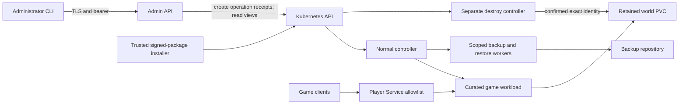

# Single-admin v1 threat model and review

Review date: 2026-10-29. Reviewed source:
`0225dc4a1da171b3aa07028ab8e94e7e77ea8cf5` (current main).
Tracking: [#37](https://github.com/gobha-me/arcadectl/issues/37).

**Release disposition: blocked.** This review records boundaries, existing
negative-test evidence, known findings, and remaining work. It is not a v1
certification, deployment approval, or acceptance of the residual risks below.
Unmerged repairs are identified separately from the reviewed default branch.

## Assets, actors, and trust

Protect retained world identity and bytes, backup artifacts and repository
credentials, administrator bearer credentials, TLS private keys, signed package
trust, operation receipts, and the installation's Kubernetes identity.

The supported product boundary is one trusted administrator and one cluster.
There is no tenant isolation claim, account database, organization model, or
untrusted runtime plugin boundary. Cluster administrators, the node/kernel,
Kubernetes control plane, signing-key custodian, curated adapter source, and
controller code are trusted. A compromised controller requires recovery of the
installation and its credentials; absence of a direct PVC-delete permission
does not make a workload-managing controller an untrusted sandbox.

Attackers considered here include unauthenticated network clients, malicious
game clients, a compromised game workload, substituted images/packages, unsafe
adapter input, forged or stale operation requests, malicious restore content,
foreign same-name Kubernetes objects, and compromised backup storage.

The diagram describes intended authorities. Kubernetes RBAC, admission policies,
typed plans, original-object checks, and exact operation receipts enforce the
individual edges; the diagram itself is not evidence of enforcement.

## Reviewed boundaries

| Surface / abuse case | Enforcement and source | Residual boundary |
| --- | --- | --- |
| Unauthenticated API requests, forged bearer, expired or rolled-back verifier | `internal/adminauth`, TLS server in `cmd/arcadectl-api`, authentication/audit wrapper in `internal/apiserver` | TLS parsers run before bearer authentication. Main still has the high-priority dependency finding below. |
| Credential rotation and accidental disclosure | Hashed verifier projection, private client files, monotonic verifier serial, fixed error codes, readiness tied to usable credentials | Trusted credential rotation and signing operations remain administrator capabilities. Private files and repository Secrets must stay outside public diagnostics. |
| API used as a direct cluster mutator | `config/api/role.yaml` permits read views and `create` on `arcadeoperations`; it grants no workload/PVC/Secret mutation or receipt-status updates | The API can admit supported administrative operations; this is a powerful single-admin authority, not tenant authorization. |
| Normal controller deletes retained worlds or manages users | `config/rbac/role.yaml` omits PVC `delete`, user-management resources, wildcard verbs, and explicit `bind`/`escalate`; destruction has a separate role/controller | Controllers still manage namespace workloads, scoped RBAC, and referenced Secrets. Treat their compromise as an installation compromise. |
| RBAC bootstrap grants more authority than the actor owns | Namespace Roles/RoleBindings and Kubernetes' role/binding escalation checks | This relies on an uncompromised API server and the shipped authorization/admission configuration. Do not add `bind`, `escalate`, or wildcard grants as a workaround. |
| Game or adapter supplies arbitrary Kubernetes/commands | `internal/platform/game/definition.go`, curated catalog, typed renderer, schema validation, immutable image resolution | Adapters are reviewed compiled Go code. This contract is not a sandbox for malicious Go contributors or remote plugins. |
| Input renders credentials into configuration/status | Settings schemas reject unknown properties; configuration targets and public status use constrained representations; controller failures discard raw causes | Settings are not a credential channel. A future credential capability needs explicit Secret references and new redaction coverage. |
| Player network publishes RCON, API, or internal ports | `internal/controller/status.go` player-endpoint allowlist and typed Service plan; API Service is ClusterIP with only HTTPS | ClusterIP alone does not restrict access from other pods. NetworkPolicy enforcement needs a supporting CNI and installation-specific review. |
| Workload gains host privilege or writes its image filesystem | Restricted namespace admission, non-root identities, RuntimeDefault seccomp, dropped capabilities, read-only root filesystems in shipped templates | Writable world volumes are intentional. Namespace/node control and a compromised runtime remain outside workload isolation guarantees. |
| Worker obtains unrelated repository credentials or world access | Exact Secret UID/revision references, operation-scoped Role rules and leases, pinned worker input, read-only backup source, separate restore candidates | Object-store confidentiality and availability also depend on storage credentials, repository policy, encryption, and retention configured by the operator. |
| Restore traverses paths or activates unverified content | `internal/workerio`, `internal/restoreworker`, restore authorization, candidate claims, digest/provenance and exact ownership checks | A backup is not a complete recovery proof until isolated restore succeeds. Retain original worlds until candidate verification and activation complete. |
| Destroy reuses an old confirmation or deletes a replacement claim | Preview expiry, exact parent/child UID, original claim identity, default verified-backup gate, journal-before-delete, observed absence | Unsafe destroy is an explicit administrator exception. It is not an ordinary stop, decommission, uninstall, or retry. |
| Signed installer adopts foreign resources or repairs uncertain effects | Offline package signature/trust key, exact manifest/source/image bindings, original UID/RV checks, durable intent, no effect replay on uncertainty | Preserve interrupted state. A later read, diagnostic label, or timeout does not establish that an effect did not commit. |
| CI, dependency, or release artifact substitution | Digest-pinned builders/runtime inputs and action SHAs; source/dirty labels; package verification and image reproducibility checks | Release SBOM, provenance/signature publication and exact-main release gating remain tracked by #39/#41. |

Kubernetes documents its
[role and role-binding escalation restrictions](https://kubernetes.io/docs/reference/access-authn-authz/rbac/#privilege-escalation-prevention-and-bootstrapping).
Creating RBAC objects alone does not authorize granting permissions the actor
lacks. This is an upstream enforcement dependency, not a newly tested cluster
claim from this review.

## Container and exposure audit

`Dockerfile` and `Dockerfile.api` produce scratch runtime images and run as
UID/GID 65532. Their builder and runtime inputs are digest-pinned. The API and
controller Deployment templates require non-root execution, read-only root
filesystems, no privilege escalation, RuntimeDefault seccomp, and dropped Linux
capabilities. The namespace anchors enforce the restricted Pod Security profile.
Game runtime identity is curated adapter data, not caller-supplied security
context. Backup, restore, and verification workers use constrained generated
plans and explicit writable storage.

The API's verifier and TLS volumes are read-only Secret projections. Raw bearer
tokens are not API environment variables. Its health port is not published by
the Service. The controller's own health endpoint is not a player endpoint.
The normal controller and destroy controller intentionally use distinct Service
Accounts and Roles. No image/CVE scan of built runtime images is claimed here;
the scans below are Go reachability scans of source, not image scans.

## Findings and release blockers

| Finding | Observed status | Remediation owner / release condition |
| --- | --- | --- |
| HIGH: Go 1.26.0 standard-library advisories and pre-authentication HTTP/2 surface, #116 | Main scan with its pinned Go version fails; admin API hardening and toolchain fixes are in unmerged #134 | Security maintainers reviewing #116/#134 must require patched images, HTTP/1.1-only configuration, and full exact-head evidence before accepting the repair. |
| MEDIUM: five reachable x/net advisories, #117 | Main still requires v0.57.0. Main source scanned with Go 1.26.10 still fails on five module advisories | Dependency maintainers reviewing #135; #134 also carries the dependency fix so its security gate can pass independently. |
| LOW: case-folded duplicate credential keys, #118 | Main parser has the reported differential; the exact-key parser repair is in unmerged #138 | Authentication/security maintainers reviewing #138 and its independent parser tests. |
| Missing API ingress restriction, #116 | Main has ClusterIP exposure but no API NetworkPolicy. #133 contains the proposed policy and reviewed operator procedure | Infrastructure/security maintainers must review the policy and prove allow/deny paths on a compatible disposable CNI profile before any installation change. This review applies nothing. |
| Fixture builder drift, #123 | Old main fixture builders use Go 1.26.0. #134 now repins them; #141 adds a builder/module-version regression guard | Build maintainers must retain both shipped and fixture pins and resolve the independent test-author requirement. |
| Native admission reliability, #94 and related CI failures | Exact typed/metadata Pod resource-version guards have refused in candidate CI. A single successful rerun does not explain the earlier refusal | Installer maintainers need attributed failure evidence and exact candidate/main proof; no timeout or identity check may be waived to certify the release. |
| Repository-wide lint evidence | The independent 2026-10-30 review of documentation head `a63053efd2525addb5ada2317dc9f17e25256ca3` found an unsuccessful local full-tree lint run | Lint policy maintainers must account for inherited debt, independently review any baseline admission, and obtain successful configured whole-tree and exclusion-free added-line checks on the integrated head. An unmerged baseline from another PR does not qualify this source. |
| Complete diagnostics and telemetry, #28/#38 | Narrow public conditions/errors exist; a complete redacted support bundle and production observability acceptance are not established | API/platform maintainers must prove every added output path with adversarial redaction controls. |
| Supply-chain and exact-main release evidence, #39/#41 | Signed installation development checks exist; complete release artifacts and release-gate evidence are outstanding | Release maintainers must bind all artifacts, scans, signatures, compatibility claims and post-merge CI to the exact release SHA. No tag/publication is authorized by this document. |

No critical/high finding is accepted as a release exception by this review.
The remaining risk decisions require explicit maintainer review. Proposed
boundaries for that review are: trusted single-admin control-plane compromise,
trusted cluster/node administration, object-store operational policy, and
curated compiled adapter code. None permits weakening exact data identity,
secret redaction, or deliberate-destroy confirmation.

## Evidence executed during this review

All commands below ran against source `0225dc4` on 2026-10-29 without applying
manifests or connecting to an operator cluster. govulncheck was pinned to v1.9.0.

| Evidence | Actual result |
| --- | --- |
| `GOTOOLCHAIN=go1.26.0 govulncheck ./...` | **FAIL**, exit 3. Reports 29 reachable standard-library vulnerabilities and includes x/net advisory traces. |
| `GOTOOLCHAIN=go1.26.10 govulncheck ./...` on unchanged main source/dependencies | **FAIL**, exit 3. Five reachable vulnerabilities from one module. Changing only the scanning toolchain does not repair the module dependency. |
| Targeted race tests for secret/redaction/foreign-resource/endpoint/credential/destroy/privilege/unsafe/traversal names in API, controller, kube plans, adapter, auth and worker packages | PASS for executed tests. Packages with no matching tests are not counted as proof of their complete suite. |
| Complete adapter-definition, catalog, built-in adapter, worker-I/O and adminauth race suites | PASS for every listed package; these are focused package checks, not complete native acceptance. |
| `TestAPIRBACAndExposureAreSeparateFromController` | PASS; verifies generated API exposure and exact two-rule operation/read authority. |

For comparison, the repaired #134 source at
`3efc872b70067eccb6bd3d7bcefcde5133aeb679` passed a local Go 1.26.10
reachability scan with zero reachable vulnerabilities and passed
[hosted Security run 40936549944](https://github.com/gobha-me/arcadectl/actions/runs/40936549944).
Its complete native CI remains separate evidence. That result does not repair
or certify the default branch until the normal review and merge process occurs.

## Review completion conditions

Before #37 can be treated as complete for v1, a security reviewer must review
the exact integrated candidate, resolve every finding above, confirm all
redaction output surfaces including future diagnostics/events/backups, and
review the independent native negative tests and image/supply-chain scans.
Archive exact-SHA candidate evidence and require exact-main CI before release.
Repeat this review when authentication, supported adapters, resource authority,
network publication, restore format, or destructive-operation semantics change.
